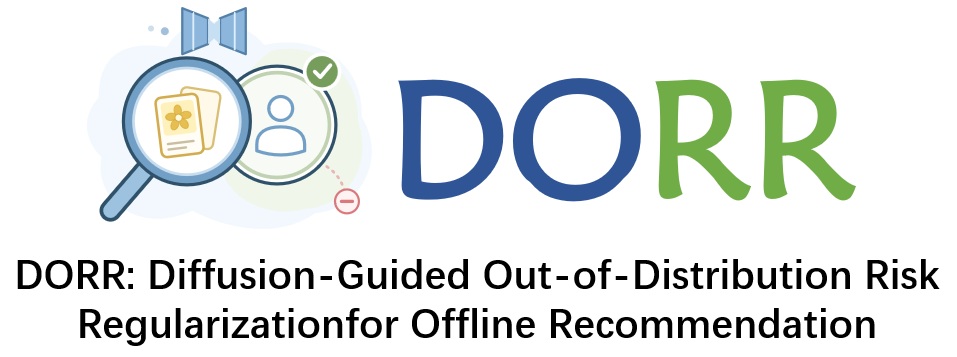
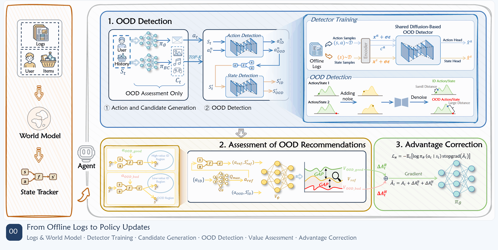

<p align="center">
  
</p>

<p align="center">
  <a href="environment.yml"></a>
  <a href="https://pytorch.org/"></a>
</p>

<p align="center">
  <a href="#overview">Overview</a> &nbsp;·&nbsp;
  <a href="#method-overview">Method</a> &nbsp;·&nbsp;
  <a href="#installation">Installation</a> &nbsp;·&nbsp;
  <a href="#datasets">Data</a> &nbsp;·&nbsp;
  <a href="#training">Training</a> &nbsp;·&nbsp;
  <a href="#evaluation">Evaluation</a>
</p>

## 📌 Overview

This repository provides the official PyTorch implementation and reproduction instructions for **DORR: Diffusion-Guided Out-of-Distribution Risk Regularization for Offline Recommendation**, with experiment logging integrated into the training scripts.

Experiments are conducted in four reinforcement learning environments: `KuaiEnv-v0`, `KuaiRand-v0`, `CoatEnv-v0`, and `YahooEnv-v0`. Dataset descriptions are available at [KuaiRec](https://kuairec.com/), [KuaiRand](https://kuairand.com/), [Coat](https://www.cs.cornell.edu/~schnabts/mnar/), and [Yahoo](https://dl.acm.org/doi/10.1145/1639714.1639717).

## 🧩 Method Overview

<p align="center">
  
</p>

DORR combines shared diffusion-based support detection with reference-guided return assessment to attenuate potentially harmful policy updates and strengthen eligible beneficial updates in offline recommendation.

## ⚙️ Installation

1. Clone this repository and enter its directory. Replace `YOUR_DORR_REPOSITORY_URL` with the URL of this repository:

   ~~~bash
   git clone "YOUR_DORR_REPOSITORY_URL" DORR && cd DORR
   ~~~

2. Reproduce the software environment using either Conda or pip:

   **a) Using environment.yml (recommended)**

   ~~~bash
   conda env create -f environment.yml
   conda activate roler
   ~~~

   **b) Using requirements.txt**

   ~~~bash
   conda create --name roler python=3.10 -y
   conda activate roler
   pip install -r requirements.txt
   ~~~

**Note:** To avoid potential package conflicts, this implementation uses a fixed local version of [Tianshou](https://github.com/thu-ml/tianshou), which is already included under `src/` and does not need to be installed manually.

## 📦 Datasets

Download the prepared environment and data bundle separately:

- [Download environments.tar.gz](https://chongming.myds.me:61364/DORL/environments.tar.gz)

Place the archive in the repository root and extract it:

~~~bash
tar -xzf environments.tar.gz
~~~

The extracted `environments/` directory provides the environment implementations, processed interaction data, user/item features, and evaluation feedback matrices.

## 🚀 Training

Complete the following preparation steps:

1. Train the world model.
2. Use `run_ood_export.py` to export frozen state and item representations.
3. Use `run_ood_detector.py` to train the shared diffusion detector and calibrate its thresholds.

After preparation, run the following command for each dataset. Each command specifies the initial policy checkpoint; adjust the checkpoint path to match the file produced by your initial policy run.

### KuaiRec

~~~bash
bash script/run_dorr_cross_env.sh train KuaiEnv-v0 saved_models/KuaiEnv-v0/A2C_with_emb/A2C_with_emb_ROLeR-e200-ws3.pt 0
~~~

### KuaiRand-Pure

~~~bash
bash script/run_dorr_cross_env.sh train KuaiRand-v0 saved_models/KuaiRand-v0/A2C_with_emb/A2C_with_emb_ROLeR-e200-ws3.pt 0
~~~

### Coat

~~~bash
bash script/run_dorr_cross_env.sh train CoatEnv-v0 saved_models/CoatEnv-v0/A2C_with_emb/A2C_with_emb_ROLeR-e200-ws3.pt 0
~~~

### Yahoo

~~~bash
bash script/run_dorr_cross_env.sh train YahooEnv-v0 saved_models/YahooEnv-v0/A2C_with_emb/A2C_with_emb_ROLeR-e200-ws5.pt 0
~~~

## 📊 Evaluation

Evaluate a trained policy using `run_DORR_Main.py` with the same model, detector, and environment settings used during training. Enable `--inference-only` and specify `--dorr-checkpoint`, `--behavior-policy-checkpoint`, and a separate `--run-name` for evaluation outputs.

Training uses predicted world-model feedback, while sequential evaluation queries fixed feedback matrices.

| Metric | Definition |
| --- | --- |
| $R_{\mathrm{tra}}$ | Mean undiscounted cumulative reward per episode |
| $R_{\mathrm{each}}$ | Total evaluation reward divided by the number of interactions |
| Length | Mean number of interactions per episode |
| MCD | Majority category domination, reported for KuaiRec and KuaiRand |

MCD measures category concentration and should be interpreted alongside reward and interaction length.

## 🔧 Key Settings

| Component | Setting |
| --- | --- |
| Policy optimizer | Adam; initial learning rate $10^{-3}$ |
| Discount factor | $\gamma=0.9$ |
| GAE parameter | $\lambda_{\mathrm{GAE}}=1$ |
| Target-network update | Polyak coefficient $0.005$ |
| Shared detector | Four hidden layers with 256 units per layer |
| Detector training | 100 epochs; batch size 256 |
| Detection thresholds | 95th percentile of task-specific calibration scores |
| Reference candidates | Behavior-cloning Top-10 |
| Maximum harmful correction weight | $0.30$ |
| Maximum beneficial correction weight | $0.25$ |
| Comparison margin ratio | $\rho=0.05$ |

The training commands specify the learning-rate schedule, correction schedules, shared architecture, and stable scoring probes explicitly.

## 📁 Repository Structure

| Path | Description |
| --- | --- |
| `run_DORR_Main.py` | DORR training and evaluation |
| `run_ood_export.py` | Frozen state/item representation export |
| `run_ood_detector.py` | Detector data splitting, training, calibration, and scoring |
| `run_worldModel_ensemble.py` | World-model ensemble training |
| `run_Policy_Main.py` | Initial policy training and shared model construction |
| `policy_utils.py` / `rew_reshape.py` | Data preparation, model loading, and reward shaping |
| `src/core/dorr/` | Reference selection, return assessment, and correction rules |
| `src/core/ood_detector/` | Diffusion detector implementation |
| `src/core/policy/dorr_a2c.py` | Integration of DORR with A2C |
| `src/DeepCTR-Torch/` / `src/tianshou/` | Local dependency implementations |
| `script/` | Dataset-specific training helpers and command configuration |
| `docs/` | Detailed training instructions |
| `environment.yml` / `requirements.txt` | Software environment specifications |

## 🙏 Acknowledgements

The implementation builds on [ROLeR](https://github.com/ArronDZhang/ROLeR). We thank its authors and the developers of [EasyRL4Rec](https://github.com/chongminggao/EasyRL4Rec), [DeepCTR-Torch](https://github.com/shenweichen/DeepCTR-Torch), and [Tianshou](https://github.com/thu-ml/tianshou) for making their research software publicly available.

## 📄 License

See [LICENSE](LICENSE) for the repository license. The bundled DeepCTR-Torch and Tianshou implementations retain their respective licenses and copyright notices.

## 📖 Citation

If you find our work useful, please cite:

```bibtex
@misc{anonymous2026dorr,
  title={{DORR}: Diffusion-Guided Out-of-Distribution Risk Regularization for Offline Recommendation},
  author={Anonymous},
  year={2026},
  note={Manuscript under review}
}
```
